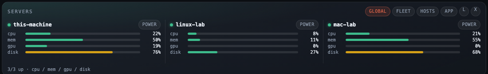

# Servers Resource Control

A tiny always-on-top Electron panel that polls **CPU**, **memory**, and **GPU** across your local machine and SSH-reachable LAN hosts.



Built as a personal ops utility: low chrome, fast glanceability, resizable layout, in-app host inventory editing, and optional sleep / restart controls for lab machines.

## Why this exists

I wanted a floating strip I could leave on a secondary display while coding. Browser tabs and heavy dashboards were too noisy, so this app is:

- Frameless and lightweight
- Persistent window size and position
- Polled over SSH multiplexing wrappers you already trust
- Safe by default for public sharing: host inventory and secrets live outside the repo

## Features

### Monitoring

- Local + remote host metrics (CPU / memory / GPU)
- Fleet summary row (average of online hosts + availability), hidden until toggled
- Light / dark theme
- Compact multi-column layout when the window is short and wide
- TCP reachability probe (IPv4-first for `.local`) before SSH sampling
- Poll watchdog so a wedged remote sample cannot freeze the panel forever

### Host inventory UI

- Top-bar **hosts** opens a full settings view (list + form)
- Edit label, kind, SSH host, port, user, and password
- Enable / disable hosts without deleting them (disabled hosts are skipped for poll / sleep / restart)
- **Add host** for a blank remote entry
- **Duplicate** clones the selected host credentials and clears hostname so you can point at another machine
- Saves to gitignored `config/hosts.json` and syncs each wrapper `.env`
- New remotes without a wrapper get `config/wrappers/<id>/ssh.sh` auto-created

### Power and schedules

- Per-host power modal: sleep or restart that machine
- Global modal: restart all, sleep all, timer all, enable / disable auto sleep
  - Restart all forces remote reboots first; this Mac restarts only if every remote confirms
  - Timer all arms a 24h `HH:MM` sleep-all countdown (fires with no confirm)
  - Auto sleep toggles overnight schedules on managed LAN hosts (macOS `pmset` 05:00 sleep, Linux `cctv-sleep.timer`)

### Window UX

- App modal: restart app, always on top (sticky when set manually)
- Hover auto-pin: window goes always-on-top on hover; shows an idle countdown chip (`inactive in M:SS`); click it to send behind for 5s (hover again to re-pin); after mouse leave, auto-off in 5 minutes unless sticky pin is on
- macOS LaunchAgent install for login auto-start

## Architecture

```text
renderer (UI + hosts settings)
    ^ metrics / settings IPC
main process
    |- local samplers (os / vm_stat / ioreg)
    |- remote samplers (SSH wrapper scripts)
    |- TCP reachability probe before SSH
    |- host settings read/write (gitignored inventory)
    '- window state + pin preference (Electron userData)
```

| Layer | Role |
| --- | --- |
| `src/main` | Electron main, polling, sleep / restart, GPU, host settings |
| `src/renderer` | Floating panel UI + hosts settings view |
| `src/shared` | Host config types + fleet aggregation |
| `bin/agentmon` | Global CLI wrapper around `serve.sh` |
| `config/hosts.json` | Private inventory (gitignored) |
| `config/hosts.example.json` | Public sample inventory |
| `config/wrappers/` | Auto-generated SSH wrappers (gitignored) |

Polling interval defaults to **2.5s**. Remote Linux CPU uses a short `/proc/stat` delta; Darwin remotes approximate CPU from load average; GPU uses `ioreg` on macOS and i915 engine runtime on Linux when available.

## Quick start

```bash
git clone https://github.com/torrefrancae/servers-resource-control.git
cd servers-resource-control
npm install
cp config/hosts.example.json config/hosts.json
# edit config/hosts.json, or launch the app and use the hosts settings UI
npm start
```

### CLI (`agentmon`)

From the repo (or after linking into your PATH):

```bash
ln -sf "$(pwd)/bin/agentmon" ~/bin/agentmon   # once

agentmon            # start (also: start | open | run)
agentmon stop
agentmon restart
agentmon status
agentmon login      # macOS login auto-start
agentmon logout
```

Or call the scripts directly:

```bash
./serve.sh --headless
./serve.sh --stop
./serve.sh --install-login
./serve.sh --uninstall-login
```

## Configure hosts

**Preferred:** open the panel, click **hosts** in the top bar, edit the form, then **save**.

You can also edit `config/hosts.json` by hand:

```json
{
  "id": "linux-lab",
  "label": "linux-lab",
  "kind": "linux",
  "source": "ssh",
  "enabled": true,
  "sshScript": "~/path/to/ssh-linux-lab.sh",
  "sshHost": "linux-lab.local",
  "sshPort": 22,
  "sshUser": "your-user",
  "sshPassword": ""
}
```

See `examples/ssh-wrapper.example.sh` and `examples/env.example`.

Notes:

- Prefer SSH keys. Keep any sudo password in local config / wrapper `.env` (`SSH_PASSWORD`), never in git.
- Disabled hosts are skipped for polling, sleep, and restart.
- New hosts without a wrapper get `config/wrappers/<id>/ssh.sh` auto-created.
- `.local` hostnames follow machines across DHCP subnet changes better than hard-coded LAN IPs.
- The monitor marks a host online after TCP port 22 succeeds (IPv4 preferred), then samples over your wrapper.

## Security posture

- No credentials are stored in this repository
- Private host names, IPs, passwords, and SSH wrapper paths belong in gitignored `config/hosts.json` / `config/wrappers/` / `.env` files
- Remote sudo passwords (if used) are passed on stdin and scrubbed from error strings
- Renderer runs with `contextIsolation`, no Node integration, and a tight CSP

If you fork this for a portfolio demo, keep your real inventory private and ship only the example config.

## Stack

- Electron 35
- TypeScript (separate main / renderer compiles)
- Plain CSS with fluid `clamp()` sizing
- Node `child_process` + `net` for SSH and reachability

## License

MIT
